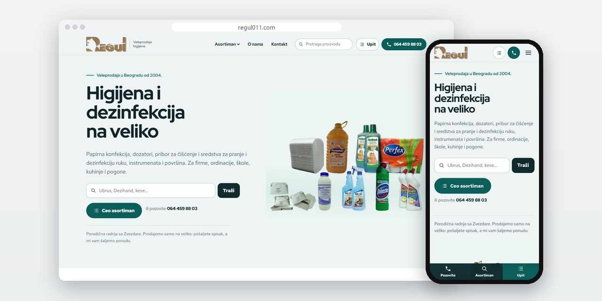
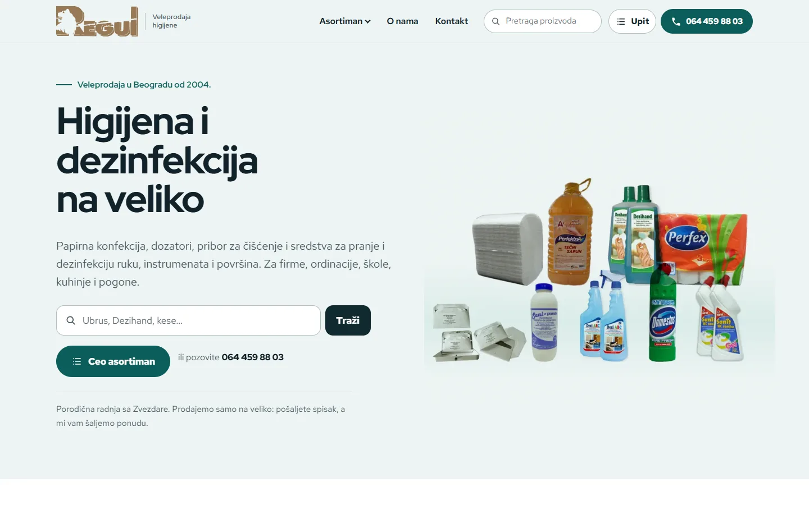
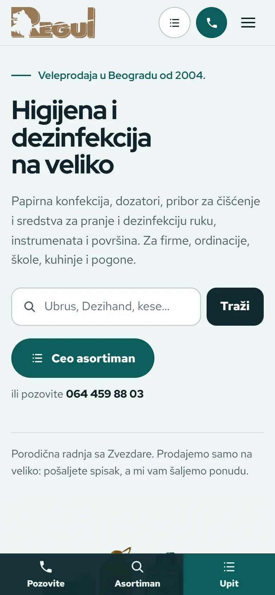
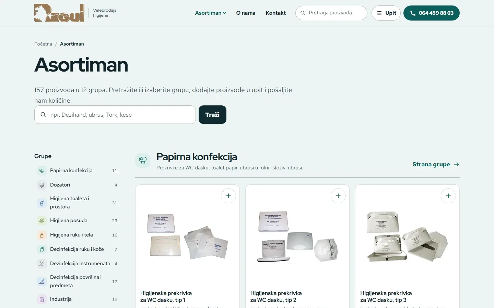
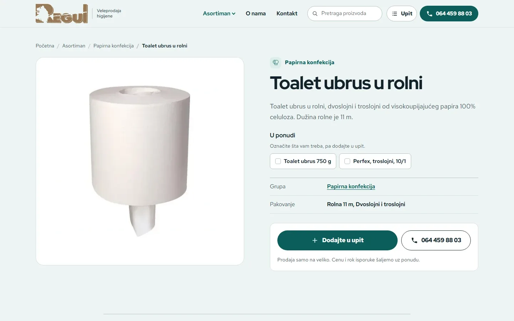

# REGUL

A wholesale catalog of 157 hygiene and disinfection products in 12 groups, where a buyer builds one list and sends it as a single quote request.

**[regul011.com](https://www.regul011.com/)** · [Case study](https://svilenkovic.com/portfolio/regul) · [Srpski](README.sr.md)

> [!NOTE]
> Client project. The source code belongs to the client and stays in a private repository. This page describes what I built and how.

<table>
  <tr><td><b>Client</b></td><td>REGUL</td></tr>
  <tr><td><b>Industry</b></td><td>Wholesale of hygiene and disinfection products</td></tr>
  <tr><td><b>Location</b></td><td>Belgrade, Serbia</td></tr>
  <tr><td><b>Type</b></td><td>B2B catalog with a quote request</td></tr>
  <tr><td><b>My role</b></td><td>Redesign, development, migration, SEO and hosting</td></tr>
  <tr><td><b>Stack</b></td><td>Node.js generator, Static HTML, PHP, WebP, JSON-LD</td></tr>
</table>

## About the project

REGUL is a family business from Zvezdara in Belgrade that has sold only wholesale since 2004: paper, dispensers, cleaning supplies and disinfectants for companies, medical practices, schools and kitchens. Prices depend on quantity and on the arrangement with each buyer, so the site works as a catalog without prices. Each product page has a short label saying the price comes with the quote.

The core of the site is the inquiry list. Every card and product page has a button that adds the product to it, and when a product comes in several pack sizes, the buyer ticks the ones they need. On the Contact page the list is already filled in, so the buyer only adds quantities, a name and a phone number, without an account. A small Node.js generator builds the group and product pages, the sitemap and the structured data from one product list, and the only thing the server runs for visitors is the inquiry form.

## What I built

- 157 product pages in 12 groups, with use, pack sizes and instructions, and descriptions matched to the shop's price lists
- Search and an index of groups with product counts on the home page, plus a section that sends each type of buyer to the right group
- An inquiry list that fills up while the buyer browses, with a counter in the header and a choice of pack sizes
- A table on the home page showing which type of toilet seat cover fits which dispenser brand
- The logo redrawn as a vector from a scan, in its original brown
- Redirects from the old site's addresses to the matching new pages

## Results

| | Performance | Accessibility | Best practices | SEO |
| :-- | :-: | :-: | :-: | :-: |
| Mobile | 100 | 100 | 100 | 100 |
| Desktop | 100 | 100 | 100 | 100 |

PageSpeed Insights, lab test of the live site, November 2026. Security headers: 6 of 6. HTML validator: no errors. axe accessibility check: no violations. Structured data: `Organization`, `WholesaleStore`.

## Screenshots

<table>
  <tr>
    <td width="68%" valign="top"></td>
    <td width="32%" valign="top"></td>
  </tr>
</table>

The product range: 157 products in 12 groups, with search and an add to inquiry button on every card

A product page: the buyer ticks the pack sizes and adds them to the inquiry, and the price comes with the quote

---

Built by [D. Svilenković](https://svilenkovic.com).
