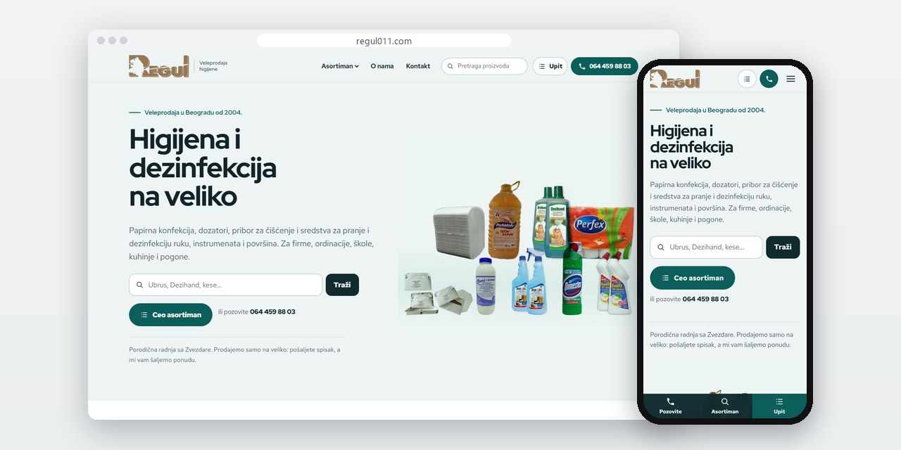
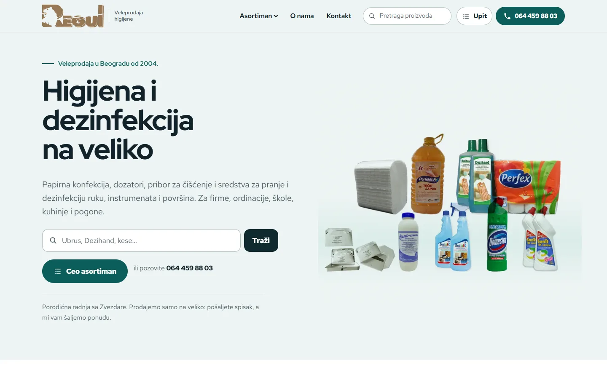
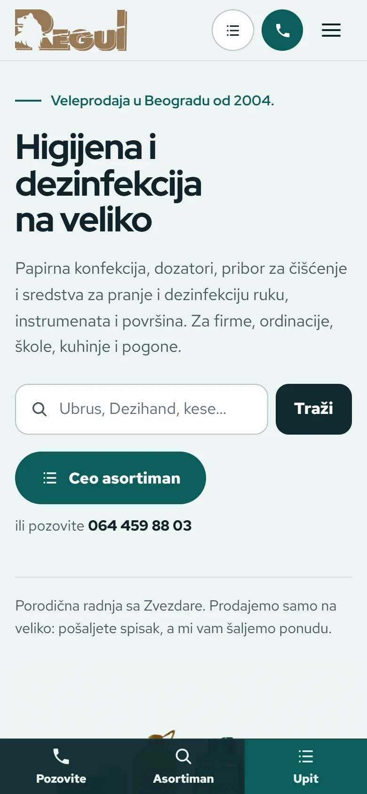
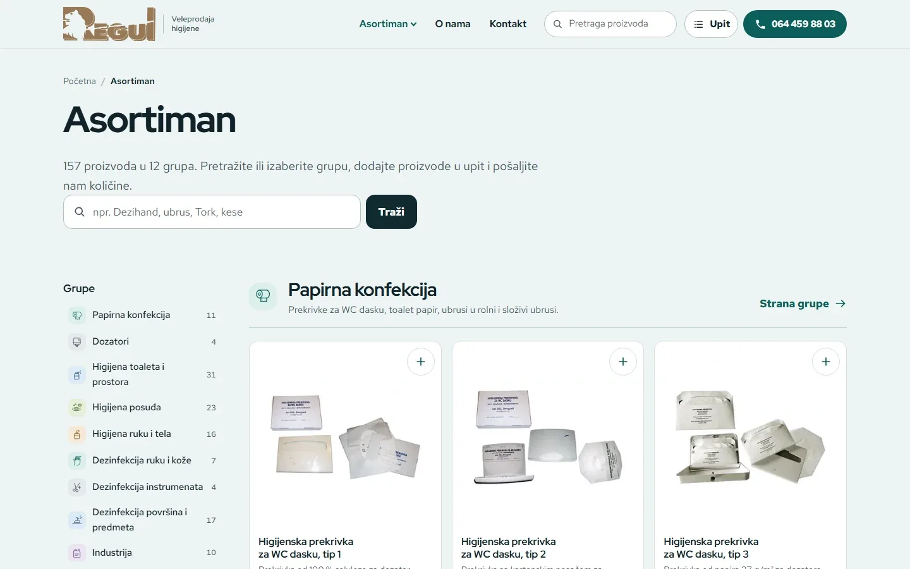
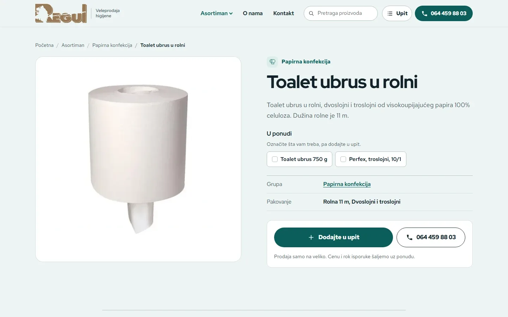

# REGUL

Katalog veleprodaje higijene i dezinfekcije sa 157 proizvoda u 12 grupa, u kome kupac sastavi spisak i pošalje ga kao jedan upit za ponudu.

**[regul011.com](https://www.regul011.com/)** · [Studija slučaja](https://svilenkovic.rs/radovi/regul) · [English](README.md)

> [!NOTE]
> Klijentski projekat. Izvorni kod pripada klijentu i čuva se u privatnom repozitorijumu. Ova stranica opisuje šta sam uradio i kako.

<table>
  <tr><td><b>Klijent</b></td><td>REGUL</td></tr>
  <tr><td><b>Delatnost</b></td><td>Veleprodaja higijene i dezinfekcije</td></tr>
  <tr><td><b>Lokacija</b></td><td>Beograd</td></tr>
  <tr><td><b>Vrsta</b></td><td>B2B katalog sa upitom za ponudu</td></tr>
  <tr><td><b>Moj deo posla</b></td><td>Redizajn, izrada, selidba, SEO i hosting</td></tr>
  <tr><td><b>Tehnologije</b></td><td>Node.js generator, Static HTML, PHP, WebP, JSON-LD</td></tr>
</table>

## O projektu

REGUL je porodična radnja sa Zvezdare koja od 2004. prodaje samo na veliko: papir, dozatore, pribor za čišćenje i sredstva za dezinfekciju, firmama, ordinacijama, školama i kuhinjama. Cena zavisi od količine i dogovora sa svakim kupcem, pa sajt radi kao katalog bez cena. Na strani proizvoda umesto cene piše „U ponudi”.

Srce sajta je spisak za upit. Na svakoj kartici i strani proizvoda je dugme koje proizvod dodaje u spisak, a kada proizvod ima više pakovanja, kupac označi ona koja mu trebaju. Na strani Kontakt spisak je već popunjen, pa kupac dopisuje samo količine, ime i telefon, bez pravljenja naloga. Mali generator na Node.js-u od jednog spiska proizvoda pravi strane grupa i proizvoda, mapu sajta i strukturisane podatke, a server za posetioca izvršava samo formu za upit.

## Šta sam uradio

- 157 strana proizvoda u 12 grupa, sa namenom, pakovanjima i upotrebom, i opisima usklađenim sa cenovnicima radnje
- Pretraga i indeks grupa sa brojem proizvoda na naslovnoj, uz odeljak koji svaku vrstu kupca vodi na grupu koja mu treba
- Spisak za upit koji se puni dok kupac obilazi katalog, sa brojačem u zaglavlju i izborom pakovanja
- Tabela na naslovnoj koja pokazuje koji tip prekrivke za WC dasku ide u koji dozator
- Logo prenet u vektor iz skena, u originalnoj braon boji
- Preusmerenja sa adresa starog sajta na odgovarajuće nove strane

## Merenja

| | Performanse | Pristupačnost | Dobre prakse | SEO |
| :-- | :-: | :-: | :-: | :-: |
| Telefon | 100 | 100 | 100 | 100 |
| Desktop | 100 | 100 | 100 | 100 |

PageSpeed Insights, laboratorijsko merenje živog sajta, novembar 2026. Sigurnosna zaglavlja: 6 od 6. HTML validator: bez grešaka. axe provera pristupačnosti: bez prekršaja. Strukturisani podaci: `Organization`, `WholesaleStore`.

## Snimci ekrana

<table>
  <tr>
    <td width="68%" valign="top"></td>
    <td width="32%" valign="top"></td>
  </tr>
</table>

Asortiman: 157 proizvoda u 12 grupa, pretraga i dugme za dodavanje u upit na svakoj kartici

Strana proizvoda: kupac označi pakovanja i doda ih u upit, a cenu dobija uz ponudu

---

Izrada: [D. Svilenković](https://svilenkovic.rs).
